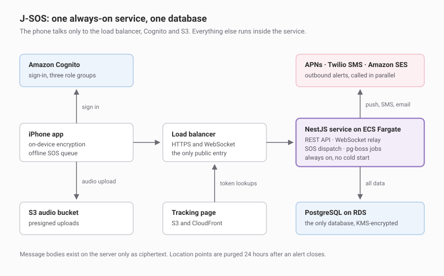

# J-SOS: architecture notes

J-SOS is an iOS safety app for journalists working in hostile conditions. One-tap SOS that reaches trusted contacts with live location, end-to-end encrypted messaging, and safety guidance that works with no signal.

This repo is the design record: how the system is put together and why. No product code lives here.

I'm the technical lead and architect. The project is funded by the Reynolds Journalism Institute and built at Authority Collective. Public site: [sourceofsafety.org](https://sourceofsafety.org).

## What runs what

| Piece | What runs it |
|---|---|
| REST API, WebSocket relay, SOS dispatch | One NestJS service on ECS Fargate |
| Public entry point | Application Load Balancer, TLS terminated there |
| Data | One RDS PostgreSQL instance, KMS-encrypted |
| Background jobs | pg-boss, inside the same service, queue in Postgres |
| Sign-in and roles | Amazon Cognito, role carried in the token |
| Alerts out | APNs, Twilio SMS and Amazon SES, called in parallel |
| Media | S3 presigned uploads with lifecycle rules, CloudFront for the one public page |
| Secrets and logs | Secrets Manager, CloudWatch with redaction |
| All of it | Terraform |

## Three decisions that shaped it

### An always-on service instead of serverless functions

The first design was Lambda behind API Gateway. It's the cheapest way to start a low-traffic app and it's where I'd normally begin.

Two requirements pushed against it. The SOS path cannot carry a cold start, because a delay there isn't a performance regression, it's a failure of the product's only real promise. And the messaging relay holds long-lived WebSocket connections with in-process fan-out, which means connection state ends up somewhere else the moment you split it into functions.

Lambda can meet the latency requirement with provisioned concurrency. But that's warm capacity under a different name, and you still end up running a dozen functions, a WebSocket API and a separate scheduler that have to be reasoned about together. One container I can run on a laptop is easier to hold in my head, and the cost difference at beta scale is small.

The trade: no scale-to-zero, so staging bills something while idle, and the scaling policy is mine to own. At a few hundred beta users that's the right side of the trade. If traffic ever gets spiky and large, it gets revisited.

### One database, not two

An earlier version ran Postgres for records and DynamoDB for the things that looked key-value shaped: the location trail during an active alert, the queue of undelivered message envelopes, and a cache.

That's a reasonable instinct and it stopped being reasonable at this scale. The beta is a few hundred people. The location trail lives at most 24 hours per alert. The message queue holds envelopes only until they're acknowledged. Two stores bought two data models, two sets of access patterns, two places to look when something breaks, and two things the next engineer has to learn.

So: one Postgres instance, about fifteen tables for the whole beta feature set, with the location trail as a table that gets purged and the job queue as pg-boss, which is also Postgres. Aurora Serverless v2 was considered and rejected along the way. Its scale-to-zero pause takes roughly fifteen seconds to resume, and there's no version of this product where the database is asleep when someone presses the button.

The trade: a single instance is a single point of failure. That's an availability risk accepted for a beta, with multi-AZ going in before public launch.

### The server never holds plaintext

The realistic adversaries here are not opportunistic. Some can compel a company to hand over data and some can reach a server. Encryption in transit and at rest does nothing against either, because in both cases the attacker ends up on the trusted side of it.

So the design assumes the server will eventually be read by someone it shouldn't be:

- libsignal on the device. The backend relays ciphertext envelopes and deletes them once delivery is acknowledged. It holds public key material and nothing else.
- Contact details, including emergency contacts, are encrypted in the application before they reach the database, with a keyed hash beside each one so duplicates can still be found without decrypting anything.
- Location points are purged 24 hours after an alert closes. Tracking links are stored as a hash of the token, never the token, so a copy of the database doesn't yield working links.
- Redaction at the logging layer, because logs are the most commonly forgotten plaintext store.
- Certificate pinning in production.

The cost is real and was accepted up front: no server-side message search, no admin tool that can read a conversation, no recovery path for a lost passphrase. Anything the server can't see, I can't see either, including when I'm debugging.

## What this costs

Roughly $55 to $75 a month for staging and $85 to $110 for production in us-east-1, before Twilio usage. These are estimates rather than quotes.

The line worth explaining is the network layout. The Fargate tasks sit in public subnets with a security group that only accepts traffic from the load balancer, and the database sits in private subnets with no internet route. The alternative, private tasks with NAT gateways, would have added one of the largest fixed costs in a small AWS footprint. The trade is explicit, it's a common pattern at this size, and it gets revisited before public launch if the security review wants private tasks.

Cost is an architecture constraint, not an afterthought. A design that's correct and unaffordable doesn't ship.

## Status

In build. Closed beta with journalist testers in January 2027.

Decision records for individual choices will land in `docs/adr/` as they're made.
